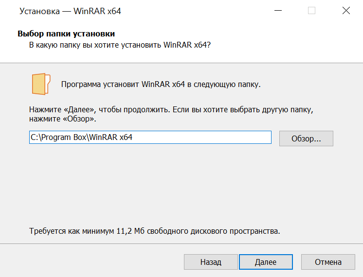

# Архиватор WinRAR


## Описание программы

WinRAR — это популярный архиватор, то есть программа для сжатия и упаковки файлов в архивы. С её помощью можно «упаковать» один или несколько файлов в один архивный контейнер, чтобы сэкономить место на диске, удобнее передавать данные или создавать резервные копии.

### Необходимые условия

Место на диске. Для самой установки достаточно небольшого объёма (порядка 50–200 МБ).

```
Совместимость с Windows. WinRAR работает на Windows 7, 8, 10 и 11. Если у вас очень старая система, возможно, придётся поискать специальную совместимую сборку.
```
```
Разрядность системы. При скачивании выбирайте версию WinRAR, которая соответствует разрядности вашей Windows (x86 для 32-битной, x64 для 64-битной) — так программа будет работать быстрее и стабильнее.
```

### Установка

Шаг 1. Перейдите на официальный сайт и скачайте установщик.

```
Шаг 2. Выберите версию, соответствующую вашей системе. Вам нужна версия, которая соответствует разрядности вашей операционной системы (32- или 64-разрядная).
```

Шаг 3. Запустите установщик. Найдите скачанный файл (например, winrar-x64-720.exe) в папке «Загрузки» и дважды щёлкните по нему.

```
Шаг 4. Установите программу. В окне установщика:
Оставьте папку назначения по умолчанию (C:\Program Files\WinRAR\) или при желании измените её.
```



| Характеристика | Описание | Примечание |
| --- | --- | --- |
| Основные форматы | 2RAR, ZIP | Также умеет читать 7z, TAR, GZ, ISO, CAB и др. |
| Максимальный размер архива | До ~8 589 934 591 ГБ (более 8 ПБ) | На практике упирается в лимиты файловой системы |
| Шифрование | AES‑128 (RAR), AES‑256 (RAR5) | Пароль защищает содержимое и имена файлов (в RAR5) |

## Автор. Ссылка на Мои проекты

* **Yaroslav Shishov** - *~~Interesting Repositories~~* - [sisovaroslav08-art](https://github.com/sisovaroslav08-art)

